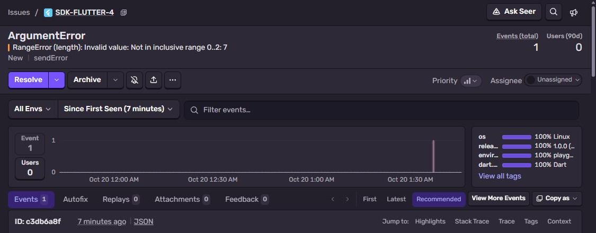
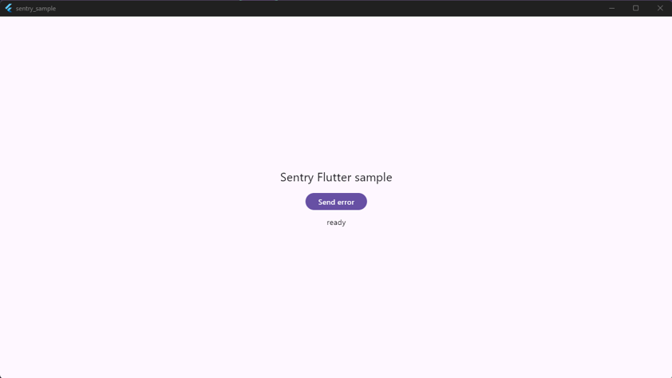
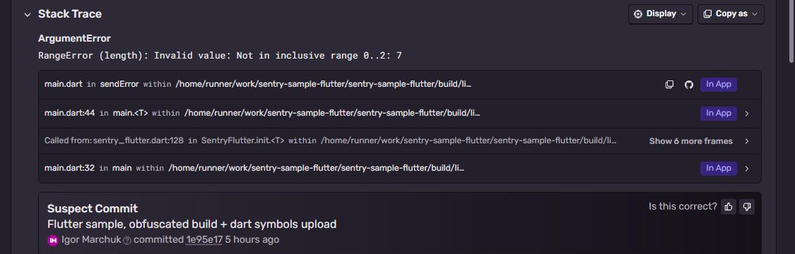

# Sentry + Flutter

Flutter app with `sentry_flutter`, built **obfuscated** with split debug info. Without the uploaded
symbols the Dart stack trace is only addresses. `sentry_dart_plugin` uploads them after the build.
Part of [Sentry Playground](https://github.com/fsmaster/sentry-playground). The playground button runs
the workflow of this repo: Linux desktop build → run once under xvfb → error.



## What you need

- [Flutter](https://docs.flutter.dev/get-started/install) stable (3.35+)
- For Windows desktop: Visual Studio with "Desktop development with C++". For Linux desktop:
  `clang cmake ninja-build pkg-config libgtk-3-dev libcurl4-openssl-dev`
- Sentry project with platform **Flutter**
- Sentry auth token: **Settings → Auth Tokens → Create New Token**

## 1. Get the code, set DSN

```bash
git clone https://github.com/fsmaster/sentry-sample-flutter.git
cd sentry-sample-flutter
flutter pub get
```

Put your DSN in `lib/main.dart` (`const dsn = ...`) and your org/project at the end of `pubspec.yaml`:

```yaml
sentry:
  org: <your-org>
  project: <your-project>
  upload_debug_symbols: true
  upload_sources: true
  symbols_path: build/symbols
```

## 2. Build obfuscated + upload symbols

```bash
flutter build windows --release --obfuscate --split-debug-info=build/symbols
export SENTRY_AUTH_TOKEN=sntrys_...
dart run sentry_dart_plugin
```

(`flutter build linux` on Linux, same flags.) Plugin output:

```
  UPLOADED 1bb4be3d-... (flutter_windows.dll.pdb; x86_64 debug companion)
  UPLOADED 49ca7cc7-... (app.windows-x64.symbols; x86_64 sources)
  UPLOADED 49ca7cc7-... (app.windows-x64.symbols; x86_64 debug companion)
Created release sentry_sample@1.0.0+1
```

## 3. Run

```bash
build/windows/x64/runner/Release/sentry_sample.exe --run test-1
```

With `--run` the app sends one error and exits:

```
SentrySample event id: 9c0d72d3b7124e9b8ce050cd9e1d60b5 run: test-1
```

Without arguments it opens a window with **Send error** button.



## 4. Check it in Sentry

**Issues** → `ArgumentError: RangeError (length): Invalid value: Not in inclusive range 0..2: 7`.
In-app frames: `sendError` → `main.<T>` (main.dart:44) → `main` (main.dart:32). In the binary these names
don't exist (obfuscated), they come back from the uploaded symbols. `Inventory.shelf` is not there, the AOT
compiler inlined it into `sendError`, normal for release builds.

Below the frames there is **Suspect Commit**: the release was created with commits and the GitHub
integration is installed, so Sentry points to the commit that last touched these lines.



## How it works

```dart
await SentryFlutter.init(
  (options) {
    options.dsn = dsn;
    options.tracesSampleRate = 1.0;
    options.addInAppInclude('sentry_sample'); // your package name
  },
  appRunner: () => runApp(const SampleApp()),
);
```

`addInAppInclude` marks frames from your own package as in-app. But careful: in an **obfuscated** build the SDK
doesn't see package names at all (they come back only after Sentry symbolicates), so this option does nothing
there and all frames are "not in app", collapsed into one line. For obfuscated builds add a stack trace rule
in **Settings → Projects → (project) → Stack Trace Rules**:

```
path:**/sentry-sample-flutter/lib/** +app
```

(your project folder name instead of `sentry-sample-flutter`). I found this the hard way, first CI events had
zero in-app frames.

`appRunner` makes sure Flutter errors (`FlutterError.onError`) and uncaught zone errors go to Sentry.

`--obfuscate --split-debug-info=build/symbols` removes Dart symbol names from the app and writes them to
`build/symbols/*.symbols`. The app then reports raw instruction addresses with a build id, Sentry
symbolicates them with those files. Same rule as native: symbols must be from the exact same build.

## CI

`.github/workflows/trigger.yml`: apt deps → `flutter build linux --obfuscate` → `dart run sentry_dart_plugin`
→ `xvfb-run sentry_sample --run <id>`.

## Troubleshooting

| Symptom | Why |
|---|---|
| Frames like `0x00007ff7` without names | Symbols not uploaded for this build, or `symbols_path` points to wrong folder. |
| `Created release` but `could not find repository` | `dart run sentry_dart_plugin` tries to set commits, it needs to run inside a git checkout. Harmless. |
| Nothing sent with `--run` | DSN empty, or the process exited before flush. The sample awaits `Sentry.close()` before `exit(0)`. |
